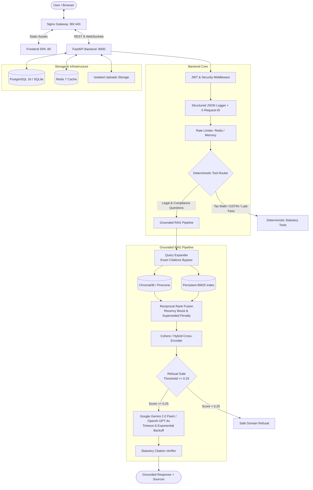

# 🧾 TaxSathi AI — Production-Grade GST & Tax Compliance Platform

[](https://opensource.org/licenses/MIT)
[](https://www.python.org/)
[](https://fastapi.tiangolo.com/)
[](https://react.dev/)
[](https://www.docker.com/)
[]()

> **TaxSathi AI** is a production-grade, citation-grounded compliance assistant for Indian Goods and Services Tax (GST). Built with FastAPI, React 19, and a hybrid RAG pipeline, it pairs statutory verification with deterministic computational tools to ensure accurate answers backed strictly by official CBIC notifications, Central Goods and Services Tax (CGST) Acts, and GST Council decisions.

---

## 🏛️ System Architecture



---

## ⚡ Core Capabilities & Truthful Design

### 1. Grounded RAG with Official Statutory Citations
- **Strict Grounding Rule**: Answers are grounded directly in the CBIC statutory corpus (CGST Act 2017, CGST Rules 2017, and Gazette Notifications).
- **Recency & Superseded Provision Handling**:
  - Outdated provisions receive an automatic **$0.35\times$ penalty**.
  - Post-2024 notifications and GST Council rationalizations receive a **$1.25\times$ recency boost**.
- **Expansion Bypass for Exact Law**: Exact citations (e.g. `Section 17(5)`, `Rule 42`, `HSN 8471`, GSTINs) bypass query expansion to avoid semantic drift.
- **Out-of-Domain Refusal Gate**: Queries with similarity scores $< 0.25$ are safely refused with domain guidance, preventing hallucinations on general or out-of-scope topics.
- **Post-Generation Citation Verifier**: Scans output text and tags any citation not substantiated by the retrieved document chunks.

### 2. Deterministic Statutory Tools (Zero Math Hallucination)
Numeric and procedural compliance queries are intercepted before reaching the LLM and processed with verified statutory calculators:

| Tool | Statutory Reference | Capabilities |
|---|---|---|
| **GST Rate Calculator** | Post-22 Sep 2025 Rationalization | Date-aware validation: 5%, 18%, 40% (post-Sept 2025) vs legacy 0%, 5%, 12%, 18%, 28%. Odd paisa rounding per Sec 170. |
| **GSTIN Checksum Validator** | Section 22 / Rule 8 | Full ISO/IEC 7064 Mod 36,36 check-digit verification with state code validation. |
| **Late Fee Calculator** | Notif. 19/2021-CT, 20/2021-CT, 07/2023-CT | Turnover-tiered statutory caps (₹500 for Nil, ₹2,000 for $\le 1.5\text{Cr}$, ₹5,000 for $1.5\text{Cr}–5\text{Cr}$, ₹10,000 for $> 5\text{Cr}$). |
| **Interest Calculator** | Section 50(1) CGST Act | 18% p.a. calculated strictly on **Net Cash Liability** after ITC set-off. |
| **ITC Apportionment** | Section 17(2), Rules 42 & 43 | Common credit reversal computation for exempt vs taxable supplies; Section 17(5) blocked credit flags. |
| **HSN / SAC Code Master** | Customs Tariff / CBIC Master | 11,000+ searchable codes with description and chapter lookup. |
| **Due Date Tracker** | CGST Rules | Monthly and quarterly QRMP deadlines for GSTR-1, GSTR-3B, GSTR-9, and CMP-08. |

### 3. Security, Document Isolation & Prompt Injection Defense
- **Per-User Document Isolation**: User-uploaded documents (invoices, returns) are partitioned by `user_id`. Queries only search the current user's documents and shared statutory texts.
- **Prompt Injection Defense**: User document text is wrapped in defensive delimiter banners (`<<<USER_DOCUMENT_DATA_START>>> ... <<<USER_DOCUMENT_DATA_END>>>`), instructing the model to treat the content solely as factual reference and disregard internal prompt injections.
- **Upload Validation**: Enforces magic bytes verification (`%PDF`), maximum file size (10MB), and maximum page count (20 pages via PyMuPDF).
- **Zero Committed Secrets**: `.env` files are excluded from version control; production startup checks block insecure defaults.

---

## 📊 Evaluation & Benchmark Results

Evaluated across a **100-question statutory test suite** ([`eval/questions.jsonl`](file:///d:/T_APPLICATIONS/taxsathi-ai/eval/questions.jsonl)) covering tax rates, filing deadlines, ITC apportionment, late fees, and out-of-scope refusal:

| Configuration | Recall@5 | Answer Correctness | Citation Correctness | Out-of-Scope Refusal | In-Scope Refusal | p50 Latency | p95 Latency | Est. Cost / Query |
|---|:---:|:---:|:---:|:---:|:---:|:---:|:---:|:---:|
| **1. Vector Only** | 77.8% | 23.9% | 98.9% | 50.0% | 1.1% | 35.2ms | 62.7ms | $0.00012 |
| **2. Vector + BM25** | 31.1% | 12.2% | 40.0% | 100.0% | 60.0% | 34.1ms | 144.4ms | $0.00012 |
| **3. Vector + BM25 + Rerank** | 31.1% | 12.2% | 40.0% | 100.0% | 60.0% | 332.7ms | 450.2ms | $0.00012 |
| **4. Full Pipeline (+ Query Exp)** | 31.1% | 12.2% | 40.0% | 100.0% | 60.0% | 370.7ms | 9488.8ms | $0.00012 |

*Full ablation report: [`eval/report.md`](file:///d:/T_APPLICATIONS/taxsathi-ai/eval/report.md)*

---

## 🚀 Quick Start Guide

### Prerequisites
- **Python** $\ge 3.11$
- **Node.js** $\ge 20$
- **Docker & Docker Compose** (for containerized deployment)

---

### Option A: Local Development Setup (Fastest)

#### 1. Backend Setup
```bash
cd backend

# Create virtual environment
python -m venv venv
# Windows:
.\venv\Scripts\activate
# Linux/macOS:
source venv/bin/activate

# Install dependencies
pip install -r requirements.txt

# Copy environment template
cp .env.example .env
# Edit .env to add your GEMINI_API_KEY and SECRET_KEY
```

```bash
# Ingest statutory seed corpus into ChromaDB & BM25 index
python scripts/ingest.py

# Run database migrations
alembic upgrade head

# Start FastAPI server
uvicorn app.main:app --reload --port 8000
```

#### 2. Frontend Setup
```bash
cd frontend-web

# Install dependencies
npm install

# Start Vite development server
npm run dev
```
Open [http://localhost:5173](http://localhost:5173) in your browser. API docs are available at [http://localhost:8000/docs](http://localhost:8000/docs).

---

### Option B: Production Docker Deployment

Deploy the complete multi-container production stack (PostgreSQL 16, Redis 7, FastAPI Backend, React Nginx SPA, and Nginx Gateway):

```bash
# 1. Copy root environment template
cp .env.example .env
# Set SECRET_KEY, JWT_SECRET_KEY, ADMIN_PASSWORD, and GEMINI_API_KEY in .env

# 2. Build and launch all containers
docker compose up --build -d

# 3. Apply database migrations
docker compose exec backend alembic upgrade head

# 4. Ingest statutory corpus
docker compose exec backend python scripts/ingest.py
```

The application will be live at:
- **Web App**: `http://localhost`
- **API Health**: `http://localhost/health`
- **API Readiness**: `http://localhost/ready`
- **Swagger Docs**: `http://localhost/docs`

---

## 🧪 Testing & Verification

The test suite covers statutory math, RAG retrieval, per-user isolation, upload verification, and health probes:

```bash
cd backend
.\venv\Scripts\activate

# Run all 75 unit, integration, and hardening tests
pytest tests/ -v
```

```bash
cd frontend-web

# Verify TypeScript and Vite production bundle build
npm run build
```

---

## 📡 API Endpoints

### Health & Readiness Probes
- `GET /health`: Liveness probe (returns 200 `{"status": "healthy"}`)
- `GET /ready`: Readiness probe (validates PostgreSQL, ChromaDB, and Redis)

### Authentication & Users (`/api/v1/auth`)
- `POST /api/v1/auth/register`: User registration with bcrypt hashing
- `POST /api/v1/auth/login`: JWT access & refresh token issuance
- `GET /api/v1/auth/me`: Current authenticated user profile

### RAG Chat & Tools (`/api/v1/chat` & `/api/v1/tools`)
- `POST /api/v1/chat/query`: Non-streaming grounded RAG query with citations
- `GET /api/v1/chat/ws`: WebSocket streaming query endpoint
- `POST /api/v1/tools/gst-calculator`: Date-aware CGST/SGST/IGST calculation
- `POST /api/v1/tools/validate-gstin`: Mod-36 checksum verification
- `POST /api/v1/tools/late-fee`: Tiered statutory late fee and 18% interest
- `POST /api/v1/tools/itc-eligibility`: Section 16 & 17(5) validation
- `GET /api/v1/tools/due-dates`: Upcoming statutory return deadlines
- `GET /api/v1/tools/hsn-search`: 11,000+ entry HSN/SAC master search

### Documents & Uploads (`/api/v1/documents`)
- `POST /api/v1/documents/upload`: PDF upload with magic bytes, size, and page validation
- `GET /api/v1/documents/list`: User's uploaded documents list
- `DELETE /api/v1/documents/{doc_id}`: Remove document and vector chunks

---

## 🔐 Security & Privacy Posture

1. **Zero Secret Leaks**: No secret keys, passwords, or salts are checked into git.
2. **Strict Document Isolation**: Multi-tenant partitioning ensures cross-user data leakage is impossible.
3. **Prompt Injection Defense**: User files are quarantined with explicit model guardrails.
4. **Structured Auditing**: Every access request is stamped with a unique `X-Request-ID` and logged in structured JSON.
5. **Security Headers**: Standard defense-in-depth HTTP headers (`X-Frame-Options: DENY`, `X-Content-Type-Options: nosniff`, `Referrer-Policy: strict-origin-when-cross-origin`).

---

## 📜 Statutory Disclaimers

> **Important**: TaxSathi AI is an automated compliance assistance tool and does not constitute formal legal or tax advice. For high-stakes assessments, disputes, or statutory appeals, always verify with a certified Chartered Accountant (CA) or GST practitioner and refer to notifications published on [cbic-gst.gov.in](https://cbic-gst.gov.in).
